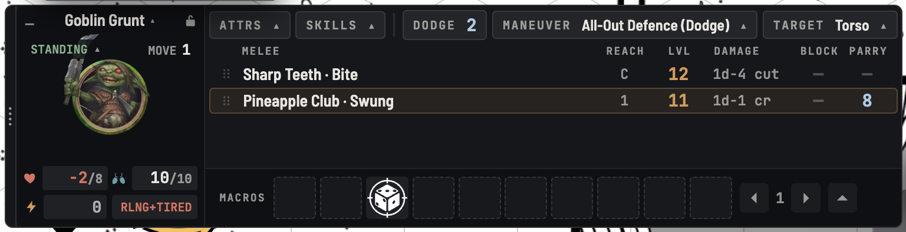
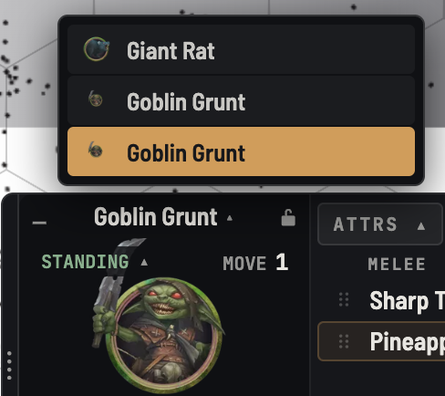
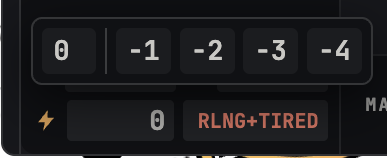
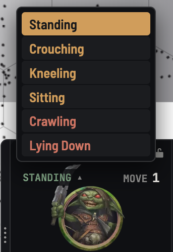
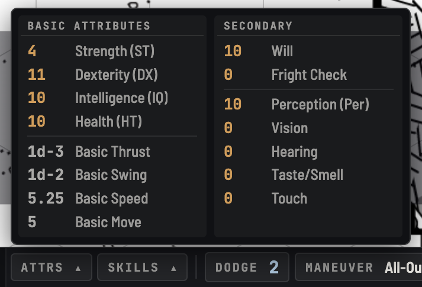
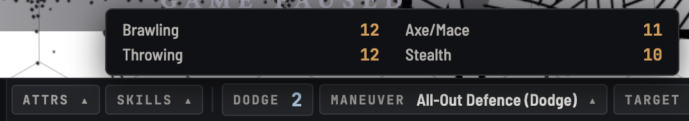
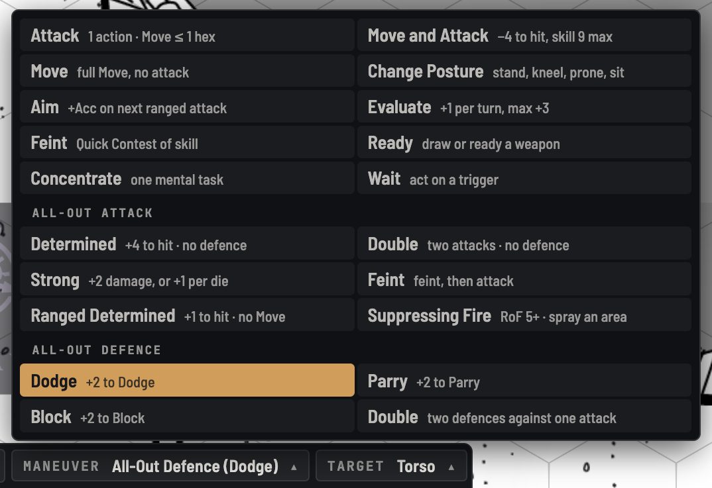
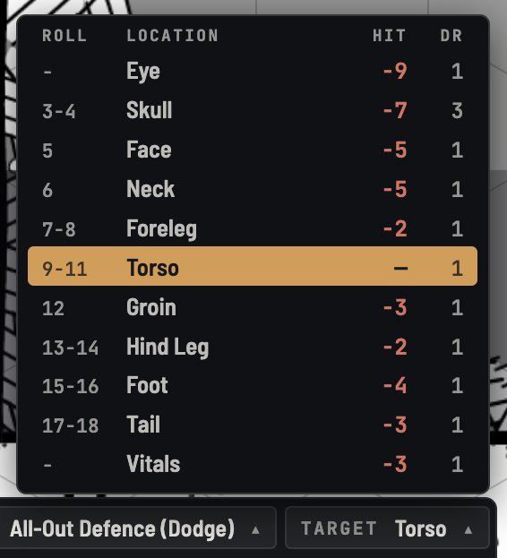

# GURPS HUD

A clean, concise heads-up display for playing [GURPS 4e](https://github.com/crnormand/gurps) in
Foundry VTT, inspired by [pf2e-hud](https://github.com/reonZ/pf2e-hud).



One strip holds what a turn needs: the character's vitals, posture and Move, the attacks they fight
with, their maneuver, the hit location they are aiming at, and their macros. Everything else on the
sheet — attributes, skills, spells — is one hover away. It is written GM-first, so it works for any
token on the canvas, NPCs included, and every roll goes through the Game Aid exactly as the
character sheet's would.

## Installation

In Foundry's **Add-on Modules → Install Module**, paste the manifest URL:

```
https://github.com/ncphillips/gurps-hud/releases/latest/download/module.json
```

then enable **GURPS HUD** in a world running the GURPS 4e Game Aid.

## Features

### Switching Characters

By default, selecting a token you can control switches the HUD to that actor. Click the lock beside
the name to keep the HUD on the current actor whatever you select.

Hover the character name to list every actor on the canvas you can control, and click one to
switch to it.



### Vitals

Click HP or FP to edit it: type a new value, or a change like `-3`. The cell beside shock shows
whether the character is reeling or exhausted.

Hover the shock cell under HP to switch shock levels on and off. The cell shows the total penalty the
Game Aid applies to your rolls; `0` clears it.



When the Game Aid's _Use Quintessence_ setting is on, Quintessence Points take the cell beside shock
and are edited like HP and FP, and reeling and exhausted move to a chip along the bottom of the
portrait.

### Posture

Hover the posture badge to change posture. The Game Aid's status effect, token icon and Move
penalty all follow.



### Always Available

#### Attributes

The basic and secondary attributes, laid out like the sheet. Click one to roll it. With _Use
Quintessence_ on, QN sits under Health.



#### Skills

Every skill on the actor. Click a row to roll it.



#### Spells

Every spell the character knows, grouped by college, with its cost to cast and maintain, casting
time and duration beside the level. Click a spell to cast it. The button only appears for
characters who have spells.

### Combat

#### Choose Which Attacks Appear

A GURPS sheet lists every attack a character could conceivably make, which is far more than fits in
a strip you read at a glance. So the HUD starts empty and you say what belongs there: drag melee and
ranged rows off the character sheet onto the strip, or press **Add every attack** to take the lot and
prune from there.

Each row is gripped by the dotted handle on its left, the same one the character sheet uses. Drag it
to reorder the attack within its group, or off the HUD entirely to take it away — `Alt`+`↑`/`↓` and
`Delete` do the same from the keyboard. Attacks only ever move within their own group, and only the
strip's own character's attacks can be dropped on it.

The choice is stored on the actor, so it comes back for everyone at the table the next time that
character is selected.

Click an attack's level to roll it, its damage to roll damage, and its parry or block to roll the
defence. In the ranged table, click a weapon's Acc to add it to the modifier bucket when aiming.

#### Select your Maneuver

Every maneuver, with All-Out Attack and All-Out Defence broken out into the variants the rules ask
you to choose between.



#### Target a Hit Location

Select an enemy and press `t` to target them. The target box now lists _their_ hit locations, with
the roll, penalty and DR of each. The location you pick has its penalty added to every attack roll
until you change it.



### Macros

The footer is a full macro hotbar. Step through its five pages with the arrows, or expand it to see
all fifty at once. Drag macros, or rows off the character sheet, onto it; drag to reorder; right-click
for Foundry's own macro menu.

**Hotbar** in the module settings picks whether you get the HUD's bar, Foundry's own, or both.

### Make It Yours

- **Move it.** Drag the dotted rail down the HUD's left edge to put it anywhere. Double-click the
  rail, or drop it near the bottom-left corner, to dock it again.
- **Minimize it.** The button left of the character's name, or `Shift`+`H`, folds the strip down so
  the canvas comes back. `Ctrl`+`Shift`+`H` hides it altogether. Both are rebindable under
  **Configure Controls**.
- **Scale and theme.** **HUD scale** draws the strip anywhere from 0.9× to 2×, and **HUD theme**
  picks dark, light, or whatever your desktop uses.

All of these are per-player and survive a reload.

## Development

The package manager is pinned in `package.json`; `corepack enable` gets you the right pnpm.

```bash
pnpm install
pnpm run setup   # shallow-clones the pinned GURPS system source into .reference/ (gitignored)
pnpm run dev     # Vite on :30001, proxying Foundry on :30000
pnpm run build   # emits dist/
pnpm run harness # the HUD against stub Foundry globals, no world needed
```

The harness serves `http://localhost:30099/modules/gurps-hud/dev-harness/index.html`; its query
parameters (`?hover_panel=attrs` and the like) are listed in `src/dev-harness/main.ts`.

```bash
pnpm test           # unit tests
pnpm run test:e2e   # Playwright against the harness
pnpm run test:a11y  # both halves of the accessibility suite
pnpm run check      # tsc and svelte-check
```

`pnpm run setup` is optional for building, but the HUD is written against the GURPS 4e Game Aid's
actor data model, so having its source on hand is how you check the real shape of `actor.system`
instead of guessing. It is pinned in `scripts/setup-reference.sh`; override with
`GURPS_SYSTEM_REPO` / `GURPS_SYSTEM_REF` to read a fork or a newer release.

Symlink the build output into Foundry, then enable the module in a `gurps` world:

```bash
ln -s "$(pwd)/dist" "$HOME/Library/Application Support/FoundryVTT/Data/modules/gurps-hud"
```

## Releasing

CI (`.github/workflows/ci.yml`) lints, type-checks, tests and builds every push to `main` and
every pull request.

To ship a version, publish a GitHub Release tagged `v<MAJOR>.<MINOR>.<PATCH>` (e.g. `v0.2.0`).
The release workflow (`.github/workflows/release.yml`) then:

1. runs the same lint / check / test gate as CI,
2. builds `dist/` and stamps `module.json` with the version from the tag and a
   version-specific `download` URL (so `src/module.json`'s version is never hand-edited),
3. attaches `module.zip` and `module.json` to the release, and
4. registers the version with the Foundry package listing via the Package Release API,
   doing a dry run first.

Step 4 only runs when the `FOUNDRY_PACKAGE_TOKEN` repository secret is set, and never for
pre-releases. Until the package is approved on foundryvtt.com, leave the secret unset: the
release still works as a manifest-URL install via
`https://github.com/ncphillips/gurps-hud/releases/latest/download/module.json`. Once approved,
copy the Package Release Token from the package's Edit page into that secret.
